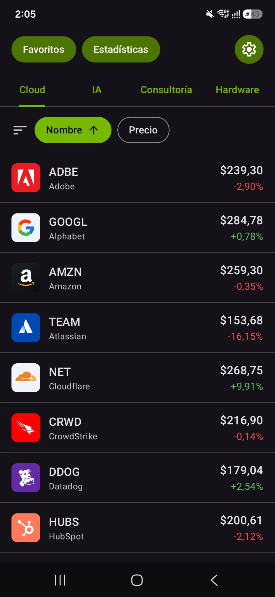
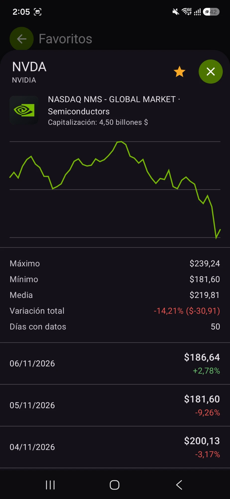
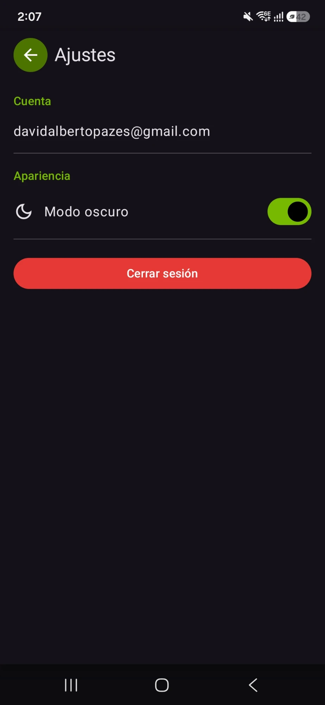

# Tech Watch

Authentication, persistence and remote services (FEM, assignment 2)

> English copy of `LÉEME.txt`.

## 1. Description

Tech Watch is an Android app to follow the stock prices of the main technology
companies, grouped in four sectors of 20 companies each (80 in total):

| Sector | Tickers |
|---|---|
| Cloud (20) | MSFT, AMZN, GOOGL, ORCL, SNOW, CRM, NOW, ADBE, WDAY, DDOG, NET, MDB, ZS, CRWD, TEAM, TWLO, PANW, OKTA, HUBS, SHOP |
| AI (20) | NVDA, AMD, PLTR, META, AVGO, TSM, SMCI, ARM, MU, INTC, QCOM, MRVL, AI, SOUN, PATH, SNPS, CDNS, VRT, CRWV, APP |
| Consulting (20) | ACN, IBM, CTSH, INFY, BAH, FCN, GLOB, EPAM, WIT, G, DXC, KD, IT, CRAI, HURN, ICFI, EXLS, EXPO, SAIC, CACI |
| Hardware (20) | AAPL, DELL, HPQ, SONY, LNVGY, XIACF, HPE, LOGI, GRMN, NTAP, WDC, STX, CSCO, ZBRA, SONO, CRSR, MSI, ANET, GLW, KEYS |

Every time the user looks at a sector, the app stores the prices it got in the
cloud. With those successive queries it builds a history per company, a chart,
statistics and a comparison between sectors.

## 2. How it meets the assignment

**Authentication.** Firebase Authentication with email and password. The login
and sign-up screens are our own, written in Jetpack Compose on top of the
Firebase Auth SDK, instead of FirebaseUI (which is based on XML views and does
not fit a Compose-only app). Sign-up, sign-in and sign-out; the session is kept
between runs; error messages in Spanish (invalid email, short password, wrong
credentials, email already registered, no network).

**Web service.** Retrofit + OkHttp + Gson, with three external services:

- Finnhub (<https://finnhub.io>), with an API key:
  - `GET /quote`: current price, change, high, low
  - `GET /stock/profile2`: name, logo, exchange, market capitalisation
- Yahoo Finance (chart API, no key, unofficial): daily closes, the last 50
  entries of each company.
- open.er-api.com (no key): exchange rates against the US dollar, to convert
  the market capitalisation. Data from Exchange Rate API
  (<https://www.exchangerate-api.com>).

Finnhub does not offer historical candles on the free plan, which is why the
history is requested from Yahoo. A throttle of our own spaces out the Finnhub
calls (at most 50 per minute).

**Persistence.** Cloud Firestore, per user: quote history (one document per
company and day) and the favourites list. The history feeds the chart and the
statistics of the detail view and the comparison between sectors. The security
rules (`firestore.rules`) prevent a user from reading or writing another user's
data. There is also local persistence: the last quote of each company
(SharedPreferences) and the logos (internal storage).

**Usefulness and complexity.** Tracking of 80 tech companies in four tech
sectors, with sorting, favourites, a detail view with chart and statistics,
comparison between sectors, currency conversion, dark mode and offline use (see
section 3).

**Documentation.** This file, screenshots (`capturas/` folder) and a video (see
section 7).

**Delivery.** A single zip without `.gradle`, `.idea` or `build`: see section 9.

## 3. Features

- Sign-up, sign-in and sign-out. Validation of the email, password length
  (minimum 6) and matching confirmation when registering. Error messages in
  Spanish.
- Quote panel per sector (tabs Cloud, AI, Consulting and Hardware, 20 companies
  each), with price and daily change in green or red. Pull down to refresh.
- Offline use: the last quote of each company is also saved on the device
  (SharedPreferences). When the app opens, that saved data is shown first and
  then refreshed; if Finnhub does not answer, it is kept and a notice says how
  old it is. The history and the statistics use Firestore's local cache. To
  avoid requesting more data than needed, quotes are requested in batches: when
  a sector is opened or on pull-to-refresh, only the rows on screen are
  requested (10 when a sector is opened, plus any row with no saved data); the
  others are requested 10 at a time when the scroll gets close to them and,
  meanwhile, show their last saved quote. When sorting by price all 20 are
  requested, because comparing prices needs all of them. A quote fetched less
  than a minute ago is not requested again when switching tabs or coming back to
  Home; pull-to-refresh requests again whatever is older than 20 seconds.
- Logos: every company shows its logo in the list and in the detail view. It is
  downloaded only once, the first time it is needed, and saved in the app's
  internal storage (`files/logos` folder); later it is read from disk, also
  offline. While it is not available the first letter of the ticker is shown.
  The download runs in the background, once per company, and is not cancelled
  if the row leaves the screen while scrolling.
- Settings: the gear button on Home (on the right) opens a screen with the
  account email, a dark-mode switch and the red "Cerrar sesión" (sign out)
  button. Dark mode is applied with a smooth transition and the choice is saved
  on the device; until it is used, the app follows the system mode.
- Sorting: on Home and Favourites the list can be sorted by company name (not
  by ticker) or by current price, ascending or descending. Tapping the active
  criterion reverses the direction. Sorting is done in the app, on the data
  already loaded, not in the query. Companies without an available quote always
  stay at the end.
- Favourites: the star in the header of a company's detail view adds it to or
  removes it from the user's list, which is synchronised with Firestore. The
  "Favoritos" button on Home shows that list.
- Company detail: tapping a row opens it as a modal sheet that slides up from
  the bottom (smooth animation, 90% of the screen) over a dimmed background. It
  is closed with the X, by tapping outside or with the back gesture. It shows
  the company logo and profile, a price chart, statistics (high, low, average,
  total change) and the list of the last 50 closing days. The market
  capitalisation is shown in dollars and, if the company is listed in another
  currency, also the original amount and the exchange rate used.
- Statistics: cumulative average change of each sector.

**Note on the data.** The history of each company is obtained in two ways. When
its detail view is opened, the last 50 daily closes are requested from Yahoo
Finance, the chart is drawn from that response and the missing days are saved
in Firestore. In addition, every time a sector is looked at, the day's quote of
its companies is saved; with the market closed the same query overwrites the
document (one per company and day) instead of duplicating it. The comparison
between sectors uses what is stored in Firestore, so it fills in as sectors and
detail views are opened.

## 4. Requirements to run it

- A recent Android Studio, with JDK 17 or later (the one bundled with Android
  Studio).
- A device or emulator with Android 8.0 (API 26) or later and an Internet
  connection.
- A free Finnhub key (included in the zip; see the next section).

## 5. Configuration

### 5.1 Finnhub API key

The zip includes a free key of the author in the `finnhub.properties` file
(project root), so the app works without any setup: open the project in
Android Studio, sync Gradle and run. It is a free-plan key (about 60 requests
per minute in total); if it were exhausted by very heavy use, just wait a
minute.

To use your own key: create a free account at <https://finnhub.io>, copy the
API key and add this line to the `local.properties` file in the root (Android
Studio creates it; it takes priority over `finnhub.properties`):

```
FINNHUB_API_KEY=your_key
```

With no key at all, the app starts but the quotes show the error message with
the "Reintentar" (retry) button.

### 5.2 Firebase

The `app/google-services.json` file is already included and points to the
author's Firebase project (with email Authentication and Firestore enabled).
Nothing needs to be changed to try the app.

To use your own Firebase project:

1. Create the project and register an Android app with the package
   `com.example.project_auth`.
2. Enable Authentication > Email/Password.
3. Create a Firestore database and publish the rules of `firestore.rules`
   (Firestore > Rules).
4. Replace `app/google-services.json` with the downloaded one.

## 6. Architecture

Kotlin + Jetpack Compose (Material 3), simple MVVM pattern without dependency
injection: each ViewModel creates its repositories by default.

```
app/src/main/java/com/example/project_auth/
  data/            AuthRepository, FirestoreRepository, StockRepository,
                   PriceHistoryRepository, ExchangeRateRepository,
                   LogoRepository, QuoteCache, QuoteLoader, ThemeSettings
    remote/        Retrofit: Finnhub, Yahoo Finance, exchange rates, throttle
  domain/          companies and sectors, statistics, sector comparison,
                   quote expiry and batches, trading currency
  ui/
    auth/          login and sign-up
    home/          quote panel and sorting
    watchlist/     favourites
    history/       detail, chart and history of a company
    stats/         sector comparison
    settings/      settings (account, dark mode, sign out)
    common/        shared components (pills, logos, stale-data notice)
    navigation/    NavHost and routes
    theme/         theme and colours (the palette is in res/values/colors.xml)
```

Data in Firestore (always under the authenticated user):

```
users/{uid}/quotes/{SYMBOL}_{yyyy-MM-dd}   price, change, high, low, time
                                           (one per company and day)
users/{uid}/watchlist/{SYMBOL}             favourites
```

Libraries: Navigation Compose, Retrofit + Gson, OkHttp (logging), Firebase Auth
and Firestore, Coil (to show the stored logos).

Icons: Google Material Symbols (<https://fonts.google.com/icons>), Apache 2.0
licence, included as vectors in `app/src/main/res/drawable` (`ic_*.xml`).

Unit tests (`app/src/test`): statistics, sector comparison, sorting, request
throttle, history, currency, quote expiry and batches, logos. Run them with
`./gradlew testDebugUnitTest`.

## 7. Screenshots and video

Screenshots: `capturas/` folder.

| File | Content |
|---|---|
| `01-listado-cloud.png` | Cloud sector list in dark mode: logos, price and daily change, sector tabs and sorting. |
| `02-detalle-nvda.png` | NVIDIA detail view: profile, market cap in dollars, chart of the last 50 closes, statistics and history; the star marks it as a favourite. |
| `03-ajustes.png` | Settings: account, dark mode and sign out. |





Video: <https://youtube.com/shorts/40HL-BrREWs?is=Omns7hczNkWqOJ2L>

## 8. Known limitations

- Finnhub free plan: request limit per minute and limited exchange coverage.
  That is why US-listed companies were chosen (Infosys is used through its ADR,
  INFY).
- Request limit: with 20 companies per sector, loading the four sectors exceeds
  the ~60 requests per minute of the free plan. The app spaces out its calls (at
  most 50 per minute) and requests quotes in batches, so if the sectors are
  browsed very quickly loading may take a few seconds. If Finnhub were to reject
  requests (HTTP 429), the list keeps the saved quotes and shows the stale-data
  notice, which in that case talks about a missing connection even though there
  is one.
- The history uses an unofficial Yahoo Finance endpoint, which may change or
  limit requests. If it fails, the detail view shows what is already stored in
  Firestore.

## 9. Delivery

To generate the zip without the unnecessary files (`.gradle`, `.idea`, `build`,
`.kotlin`, `.git` and `local.properties`, which holds paths of the author's
machine), from the project root and with PowerShell 7:

```
pwsh scripts/crear-zip.ps1
```

It creates `tech-watch.zip` on the Desktop, with the `LÉEME.txt` file, the
`capturas/` folder, `finnhub.properties` (Finnhub key) and
`app/google-services.json` (the author's Firebase project).
